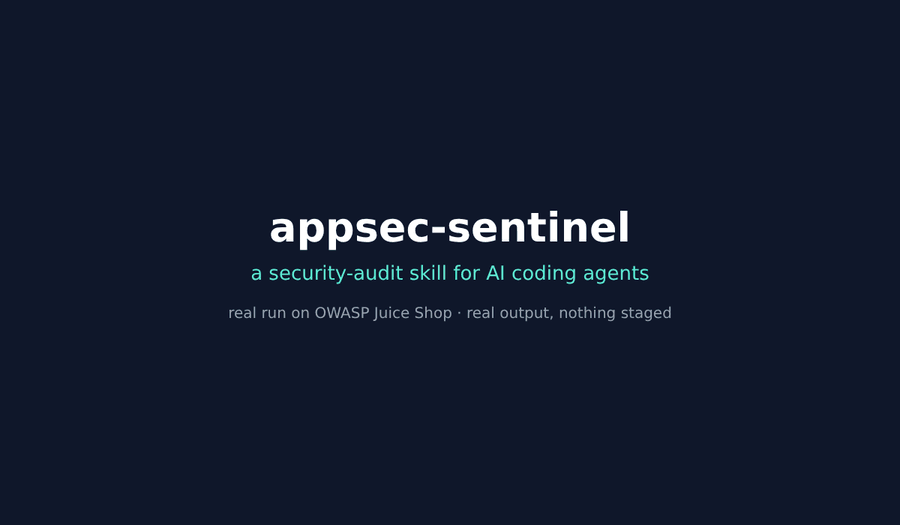
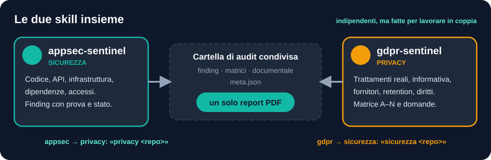

<div align="center">


<br>


[](https://dextsamu.github.io/appsec-sentinel/index.en.html)

## 🇮🇹 [Leggi in italiano →](README.it.md)

**A security report is only worth as much as its honesty.**
This skill turns your AI agent into an assessment lead that *proves* what it claims and writes down, in plain words, what it could not verify. Built for Claude, also tested on Codex and Antigravity: see [`docs/ALTRI-AGENTI.md`](docs/ALTRI-AGENTI.md) (in Italian).

> 🗒️ **Get started**: the one-page [command card](docs/COMMAND-CARD.md). Every command works in English or Italian (`quick`/`rapido`, `refute`/`smentita`, `close`/`chiudi`…).
>
> 🤝 **Sister skill**: for privacy use [`gdpr-sentinel`](https://github.com/dextsamu/gdpr-sentinel) (privacy notice vs code, suppliers, retention, data-subject rights). Together they produce a single PDF report: see [With gdpr-sentinel](#with-gdpr-sentinel).

<br>
<sub>Real run on the OWASP Juice Shop bench: real commands and output, nothing staged. 23 of 32 vulnerabilities found with file and line.</sub>

[Why](#why-it-exists) · [How it works](#how-it-works) · [Example](#example-session) · [Installation](#installation) · [Limits](#what-it-does-not-do) · [FAQ](#faq)

</div>

---

## Why it exists

Whoever receives a report decides budget and priorities from what is marked *tested*. Writing "verified" on a test that never ran is worse than not running it: it gives a sense of security that isn't there.

`appsec-sentinel` makes the agent follow a method where this cannot happen silently.

<div align="center">

</div>

| | Rule | What changes for you |
|---|---|---|
| 🔐 | **Authorization first** | No active test without a scope, an owner and a written go-ahead |
| ⚖️ | **Examined, proven, unknown** | The report never mixes what was read with what was demonstrated |
| 📏 | **Real denominators** | "27 of 52 endpoints", not "good coverage" |
| 🚫 | **No fake tests** | If a tool is missing, the test is "prepared, not run", with the command ready |
| ☣️ | **The analysed material is hostile** | Code, comments and tool output cannot widen the mandate |

<div align="center">

</div>

## What you get

| Output | Content |
|---|---|
| 🧭 **Owner summary** | Proven risks, impacts, priorities and limits, without invented percentages or certifications |
| 🔎 **Technical report** | Structured findings and chained scenarios, keeping verified apart from hypotheses |
| 🗺️ **Inventory and threat model** | Files, routes, roles, data, integrations, trust boundaries (STRIDE and LINDDUN) |
| 📊 **Coverage matrices** | Files inventoried/examined; endpoints × identities × tenants × actions; controls applicable/verified |
| ✅ **Controls matrix** | Source → applicability → evidence → status → gap |
| 🤖 **Automation** | Route inventory, local access tests, scanner import, finding review and refutation, cumulative coverage across audits, redaction check, audit comparison, CSV/SARIF/Markdown export |
| 📄 **PDF report** | Full, short executive version, English labels, comparison between audits and an indicative NIS2 mapping |
| 🛠️ **Action plan** | Containment, fixes, retests and open questions for the owner, infrastructure, DPO and suppliers |

Data is stored as Markdown, JSON and CSV in a **confidential** audit folder created outside the repository.

## How it works

<div align="center">

</div>

<details>
<summary><b>The phases in detail</b> (table)</summary>

| Phase | What is checked | Reference |
|---|---|---|
| 1 Intake and gate | Scope, environments, authorizations, mode, baseline | `engagement-rules.md` |
| 2 Inventory | Files, routes, assets, roles, data, environments; endpoint matrix | `inventory-threatmodel.md` |
| 3 Threat model | Flows, trust boundaries, chained paths | `inventory-threatmodel.md` |
| 4 Identity and authorization | Sessions, MFA, OAuth, secrets, BOLA/BFLA, tenants | `identity-authz.md` |
| 5 Input, API, files, logic | Injection, XSS, SSRF, CSRF, webhooks, business logic | `input-api-business.md` |
| 6 Infrastructure and supply chain | Database, cryptography, cloud, containers, CI/CD, SBOM, recovery | `infra-supplychain-ops.md` |
| 7 AI and automation | Prompt injection, RAG, tools, agents (if present) | `ai-features.md` |
| 8 Availability and cost | Application DoS, denial of wallet (only if authorized) | `availability-gated.md` |
| 9 Privacy | Real processing, GDPR/ePrivacy | skill [`gdpr-sentinel`](https://github.com/dextsamu/gdpr-sentinel) |
| 10 Validation and plan | False positives, deduplication, retest | `SKILL.md` |

References are loaded **only for the active phases**: the skill stays light and uses context only where it is needed.
</details>

### Three modes

| Mode | When | What it includes |
|---|---|---|
| ⚡ `quick` (`rapido`) | You have a few hours | Attack surface, secrets, authn/authz on the main flows, dependencies with reachable advisories |
| 🎯 `standard` *(default)* | The normal case | Threat model, static analysis, authorized dynamic checks, ASVS controls matrix for the relevant chapters |
| 🔬 `full` (`completo`) | Critical applications | File-by-file inventory, extended ASVS (L3 assessed for applicability), complete matrices, availability if authorized |

> [!IMPORTANT]
> With **only the repository**, the skill does static analysis and states its limits. With **only an authorized URL**, it works as an external assessment. Without authorization, active tests are prepared and **not run**.

## Example requests

```text
Run a standard assessment of the web app in this folder.

Check whether the API in this repo has authorization problems between tenants.

Quick security triage of the project: secrets, login and vulnerable dependencies.

Prepare the rules of engagement to test https://staging.example.com with the test accounts.

Check the technical NIS2/ACN side of this management app against the AgID baseline.
```

## Example session

> Ready-made phrases for every mode: [`docs/ESEMPI-DI-UTILIZZO.md`](docs/ESEMPI-DI-UTILIZZO.md) (in Italian). A complete anonymized test run from a real case: [`examples/collaudo-rapido/`](examples/collaudo-rapido/README.md).


The rhythm of the work, from a real test run (a Next.js web app owned by the person using the skill, `quick` mode, anonymized):

> **You:** Try the skill on this repository, it's mine. Tell me what to do.
>
> **Agent:** I suggest `quick` mode: attack surface, secrets, access and dependencies. Before touching the code I need three confirmations: that the repository is yours, that the work is static analysis only (no requests to servers, no active tests), and the mode.
>
> **You:** Yes, it's mine, static analysis only. Quick.
>
> **Agent:** I'm writing the rules of engagement with your confirmation and creating the audit folder outside the repository. Secret values won't end up in the report: I only record location, type and shape.
>
> *(at the end)* Seven findings, all "confirmed from code or configuration": no dynamic test, so none "reproduced". Two high: an unauthenticated demo endpoint and a framework version with known middleware bypasses. Coverage: 14 routes read out of 309, over 280 "unknown"; 0 tests run on 9 endpoints listed. Attached are the questions for whoever runs the project, starting with: are these routes in the production build?

The full case, with anonymized findings, is in [`examples/collaudo-rapido/`](examples/collaudo-rapido/README.md).

## What a finding looks like

Every finding follows the same template (`assets/finding-template.md`) and is recorded in JSON according to `assets/finding.schema.json`. Here is one from the real case, anonymized; all five are in [`examples/collaudo-rapido/findings/findings.json`](examples/collaudo-rapido/findings/findings.json):

<div align="center">

</div>

Four states, never mixed: dynamically reproduced (`riprodotto dinamicamente`), confirmed from code or configuration (`confermato da codice o configurazione`), hypothesis to validate (`ipotesi da validare`), not verifiable (`non verificabile`). The script `validate_findings.py` checks the honesty rules: a "reproduced" finding must have the test that was run, a CVSS score must state its version, and no secrets may appear in the fields.

## Minimum controls by risk class

`references/minimum-controls-profile.md` and `assets/minimum-controls-profile.csv` say **how much rigor to expect** on 14 topics, for Low, Medium or High assets. Every threshold states its **origin**: *from a source* (AgID, ACN, NIST SP 800-53B), *proposed* (ours, to be confirmed with the owner) or *to be defined*. Where the sources set no number, for example the days to apply patches, none is invented and passed off as a rule.

<div align="center">

</div>

## Baselines and sources

| Level | References |
|---|---|
| **Default** | OWASP ASVS 5.0.0, WSTG, API Security Top 10, OWASP LLM Top 10, NIST SP 800-115, SP 800-218, CSF, SP 800-63 |
| **Optional** | AgID minimum ICT measures for Italian public administrations, ACN NIS2 basic measures, NIST SP 800-53 Rev. 5 with the 800-53B baselines, Italian National Framework (CINI), ISO/IEC 27001, CIS Controls |
| **Yours** | Any in-house baseline: the skill asks for the document, records its version and date, and applies it with the same rules |

Links are in `references/baselines-sources.md` with the date they were checked. Baselines are a **yardstick**, not a certification.

## Commands

> 🗒️ Short version, one page: [**command card**](docs/COMMAND-CARD.md).

Skills have no native sub-commands: the words below are a **convention defined in the instructions** (`SKILL.md`). Where the agent supports it (for example Claude Code) you can prefix the skill name with a slash; elsewhere, write the phrase in chat. Every command also works with its Italian word. No command skips the authorization check.

| Command | What it does |
|---|---|
| `/appsec-sentinel quick <repo>` | Targeted triage: attack surface, secrets, access, dependencies |
| `/appsec-sentinel standard <repo> [url]` | Threat model, static analysis and authorized dynamic checks |
| `/appsec-sentinel full <repo> [url]` | File-by-file inventory and complete matrices |
| `/appsec-sentinel area <authz\|secrets\|dependencies\|infra\|input\|ai> <repo>` | Only the given area |
| `/appsec-sentinel retest <ID> [branch]` | Repeats the original case and tries alternative paths |
| `/appsec-sentinel plan [folder]` | Action plan from the findings |
| `/appsec-sentinel report [folder]` | Validates findings and coverage, produces the summary and the report |
| `/appsec-sentinel status [folder]` | Summary of coverage and open findings |
| `/appsec-sentinel documentary <repo>` | Documentary audit of the whole codebase and application, then a corporate PDF report |
| `/appsec-sentinel inventory <repo>` | Draft endpoint matrix, with routes lacking evident authentication first |
| `/appsec-sentinel dynamic <config> <tests>` | Access tests on a local instance or a host authorized in writing |
| `/appsec-sentinel scanner <file…>` | Imports npm audit, SARIF, gitleaks, osv as "hypothesis to validate" candidates |
| `/appsec-sentinel review [folder]` | Independent review of the findings: false positives and inconsistencies |
| `/appsec-sentinel close [folder]` | Delivery check in one step: zero "FAIL" before handing the audit to the client |
| `/appsec-sentinel refute [folder]` | A verifier other than the author tries to refute every high or critical finding |
| `/appsec-sentinel resume <old> <new>` | Repeated audit: still-valid coverage carried over, changed items marked "stale" |
| `/appsec-sentinel compare <old> <new>` | Resolved, new and changed between two audits (retest) |
| `/appsec-sentinel export [folder]` | CSV, SARIF or Markdown for issues |
| `/appsec-sentinel redact [folder]` | Checks for secrets and personal data before delivery |
| `/appsec-sentinel pdf [folder]` | Builds the PDF report from the audit files (options: `--sintetico`, `--lang en`, `--previous`, `--nis2`) |
| `/appsec-sentinel privacy <repo>` | Hands over to `gdpr-sentinel` |

Command-line scripts:

```bash
python3 scripts/init_audit.py <audit-folder> [--force]     # creates the audit folder (outside the repo)
python3 scripts/validate_findings.py <findings.json>       # validates findings against the schema
python3 scripts/coverage_summary.py <audit-folder>         # real coverage denominators
pip install reportlab                                       # once
python3 scripts/build_report_pdf.py <audit-folder>         # corporate PDF report
```

Full examples: [`docs/ESEMPI-DI-UTILIZZO.md`](docs/ESEMPI-DI-UTILIZZO.md) (in Italian).

## Automated tools

Scripts in `scripts/` speed up repetitive work without deciding for you. Flow and limits in [`references/automation.md`](references/automation.md).

| Script | What it does | Stated limit |
|---|---|---|
| `inventory_routes.py` | Lists routes and methods (Next.js, Express, Flask, FastAPI, Django, Laravel, Spring, ASP.NET, Rails, Go) and flags those without evident auth | Heuristic: it does not prove that a control is correct or missing. It reads Laravel groups (middleware and prefix), Django view auth (decorators, mixins, DRF permissions) and `include()` prefixes; for other frameworks it looks for auth near each route (global filters are not seen) |
| `dynamic_authz_check.py` | Tests access per identity on a local instance | Localhost or an authorized host only; safe methods only by default; no bodies saved |
| `import_openapi.py` | Imports an OpenAPI/Swagger spec (JSON/YAML) as the endpoint matrix; with `--repo` it compares it with the code inventory | The spec states intent, it does not prove protection; the comparison inherits the inventory's heuristic limits |
| `iac_check.py` | 14 pattern rules on Dockerfile, compose, Kubernetes, Terraform, GitHub Actions; outputs SARIF | Hints, not a replacement for trivy/checkov; secret values never reported |
| `prepass.py` | Runs every tool in a fixed order, pre-fills the 14-area `quick` checklist and lists the dangerous code to read (unescaped HTML, client side too, code execution, deserialization, XML, AI, password recovery, SSRF, client routes, seed credentials) | Identical between runs; candidates are hypotheses, not findings |
| `merge_audits.py` | Merges several runs on the same repo by cause (file/lines, CWE, title; never by ID) and measures agreement | A cause seen by one run only is not less true |
| `secret_triage.py` | Ranks possible secrets in the Git history (format, entropy, placeholders, file type, repetitions) without ever reporting the value | Heuristic: a low score does not mean harmless |
| `run_scanners.py` | Runs `npm audit` on the lockfile alone (pip-audit if present) and looks for secrets in the Git history (gitleaks or built-in patterns) | If a scanner does not start, it says so with the prepared command; shallow clones flagged; values never reported |
| `import_scanner.py` | Turns scanner output (npm audit, SARIF, gitleaks, osv, semgrep, trivy, ZAP) into candidates | Always hypotheses, severity never above "medium", secret values never reported |
| `verify_findings.py` | Looks for nonexistent references, severity without evidence, duplicates; prepares the refutation brief for high findings | Mechanical: the review questions and the refutation stay with the reader |
| `canonicalize.py` | Converts states and severities written in English to the canonical Italian values | Touches only enumerated values, never free text |
| `check_delivery.py` | One check before delivery: findings, reviewer, refutations, redaction (including the app's own secret values), forbidden words, coverage, dangerous-code categories closed | Mechanical: it does not prove the audit is right; it cannot see chat messages |
| `coverage_carry.py` | Repeated audits: carries over coverage whose content is unchanged, marks stale items and areas never covered | The fingerprint proves the content did not change, not that the review was right |
| `redact_check.py` | Looks for secrets and personal data in files and PDFs | Never prints the value; a clean result is not a guarantee |
| `compare_audits.py`, `export_findings.py` | Retest between two audits; CSV, SARIF, Markdown | "Resolved" means absent, not verified |

The scripts are tested against a fake app with known flaws: `python3 tests/run_checks.py`. The agent's behaviour is tested with the [runs in `tests/scenarios`](tests/scenarios/README.md), and its ability to find flaws with public benches: [`tests/bench-app`](tests/bench-app/README.md) (Node/Next.js, 16 known flaws), [`tests/bench-php`](tests/bench-php/README.md) (Laravel, 13) and [`tests/bench-django`](tests/bench-django/README.md) (Django, 11), each with 5 decoys, plus [`tests/bench-juice`](tests/bench-juice/juice_bench.py), where the truth is written by others (32 OWASP Juice Shop vulnerabilities with file and line). Results of the real runs in [docs/BENCHMARK.md](docs/BENCHMARK.md) and [docs/ALTRI-AGENTI.md](docs/ALTRI-AGENTI.md) (in Italian): 13/13 on Laravel, 11/11 on Django, up to 23/32 on Juice Shop; our own benches measure how the method is applied, Juice Shop measures generalization.

## Corporate PDF report

The `documentary` command examines the documents of the whole project (README, guides, policies, DPIA, plans, test reports, instruction files) and **compares them with the code**: a security claim the code does not back up is the most useful finding. Then `scripts/build_report_pdf.py` assembles an A4 PDF with cover, owner summary, finding overview and detail, documentary audit, coverage with real denominators, action plan and disclaimers.

Options: `--sintetico` for a short version for management (cover, summary, overview, plan), `--lang en` for English titles and labels (the content stays in the language of the files), `--previous <findings.json>` to add a comparison with a previous audit, and `--nis2` for an **indicative** mapping onto the measures of NIS2 Article 21, which neither decides whether the entity is in scope nor assesses compliance. The theme is teal for security and amber for privacy.

An anonymized example from a real case: [`examples/collaudo-rapido/report-esempio.pdf`](examples/collaudo-rapido/report-esempio.pdf). Method: [`references/documentary-audit.md`](references/documentary-audit.md).

## With gdpr-sentinel



`appsec-sentinel` looks at **security**; its sister skill [`gdpr-sentinel`](https://github.com/dextsamu/gdpr-sentinel) looks at **privacy**: real processing, privacy notice vs code, suppliers, retention, rights. They work on their own, but together they complement each other:

- **From security to privacy**: when you find personal data, `/appsec-sentinel privacy <repo>` hands the work to `gdpr-sentinel`, which starts from the same audit folder.
- **From privacy to security**: a security finding that affects data protection (GDPR Art. 32) is already in your matrix; `gdpr-sentinel` refers to it instead of redoing it.
- **One report**: if both skills write to the same folder, `scripts/build_report_pdf.py` produces a single PDF with findings, documentary audit, privacy matrix and questions.

## Installation

**Claude.ai**: download `appsec-sentinel.skill` from the [Releases](https://github.com/dextsamu/appsec-sentinel/releases) and upload it under *Settings → Capabilities → Skills*.

**Claude Code**, as a plugin (updates itself to new versions):
```text
/plugin marketplace add dextsamu/appsec-sentinel
/plugin install appsec-sentinel@appsec-sentinel
```
The sister skill installs from the same marketplace: `/plugin install gdpr-sentinel@appsec-sentinel`. Alternatively, as a skill folder:
```bash
git clone https://github.com/dextsamu/appsec-sentinel ~/.claude/skills/appsec-sentinel
```
or, for a single project, in `<project>/.claude/skills/appsec-sentinel/`.

**Other agents** (Codex, Antigravity): see [`docs/ALTRI-AGENTI.md`](docs/ALTRI-AGENTI.md) (in Italian) for the install paths and what was tested.

### First run

1. Open a session on the project to examine.
2. Ask for an assessment: the skill proposes the mode and the intake questions.
3. Fill in and confirm the rules-of-engagement document (`00-regole-di-ingaggio.md`).
4. The skill creates the audit folder outside the repository with `scripts/init_audit.py`; the script refuses to write inside a Git repository unless you pass `--force`.
5. At the end the skill runs the final checks: `validate_findings.py` and `coverage_summary.py`.

## Structure

```
SKILL.md                      gate, modes, phases, rules, pointers
references/                   loaded only when needed
  engagement-rules.md  inventory-threatmodel.md  identity-authz.md
  input-api-business.md  infra-supplychain-ops.md  ai-features.md
  availability-gated.md  baselines-sources.md  optional-baselines.md
  minimum-controls-profile.md  automation.md  review-pass.md  refutation-pass.md
assets/                       templates and schema
  engagement-rules-template.md  finding-template.md  finding.schema.json
  coverage-matrix.csv  endpoint-matrix.csv  controls-matrix.csv
  minimum-controls-profile.csv
scripts/                      Python standard library only (jsonschema optional)
  init_audit.py  validate_findings.py  coverage_summary.py  build_report_pdf.py
  inventory_routes.py  import_openapi.py  iac_check.py  dynamic_authz_check.py  import_scanner.py  verify_findings.py
  compare_audits.py  export_findings.py  redact_check.py  coverage_carry.py
tests/                        test apps with known flaws and run_checks.py
examples/                     anonymized quick run (from a real case) + reference findings for the automated tests
```

The skill's own instructions, references and templates are written in Italian (the authors work with Italian public administrations and non-profits); the agent applies them and answers in your language. Machine-readable files keep canonical Italian field names and enum values because the scripts check them.

## What it does not do

- It does not find "all" vulnerabilities and does not certify the security or compliance of anything.
- It does not replace a penetration tester, a DPO or a lawyer.
- It does not test production or unauthorized systems and does not change the product: it proposes fixes to apply under a later mandate.
- It does not run tools it doesn't have: if Docker, a scanner or the network are not available, it prepares the commands to run in the client's environment.
- It does not send personal data, secrets or private code to third-party services without authorization.

## FAQ

<details>
<summary><b>Do the scripts replace scanners?</b></summary>

No. The scanners remain yours: the skill imports their output as "hypothesis to validate" candidates and governs rules, coverage, validation and the report. The route inventory is heuristic, and dynamic tests prove only what they ran.
</details>

<details>
<summary><b>Can I run the dynamic tests on production?</b></summary>

`dynamic_authz_check.py` refuses any host that is not local, unless you pass `--allow-host` for a host authorized in writing, and by default it only sends read requests. On production the Phase 0 rules of engagement still apply: synthetic data, agreed limits and time windows.
</details>

<details>
<summary><b>Can I use it on a client's website?</b></summary>

Only with written authorization from the owner of the systems. The skill runs no active tests without a confirmed scope, but responsibility for its use stays with you: unauthorized access to a computer system can be a crime (in Italy, for example, Art. 615-ter of the Criminal Code).
</details>

<details>
<summary><b>Does it work with my scanning pipeline?</b></summary>

Yes. If you already have SAST/SCA scripts or dynamic tests on a local instance with fake data, say how to run them: the skill uses them as an automated phase and takes care of rules, coverage, manual validation and the report.
</details>

<details>
<summary><b>Do I need to know ASVS or WSTG?</b></summary>

No. The skill guides you and puts the references in the findings. If you want to know why a check is required, ask.
</details>

<details>
<summary><b>Do I also need gdpr-sentinel?</b></summary>

No, the two skills work separately. If [`gdpr-sentinel`](https://github.com/dextsamu/gdpr-sentinel) is installed, `appsec-sentinel` calls it for the privacy phase (`/appsec-sentinel privacy <repo>`) and both use the same audit folder; otherwise it states the limit and prepares the questions for the DPO and the lawyer.
</details>

<details>
<summary><b>Can I adapt it to an in-house baseline?</b></summary>

Yes: see "Baselines and sources" and `references/optional-baselines.md`.
</details>

## Project status

What comes next, in order and with the number each item must improve: [ROADMAP.md](ROADMAP.md) (in Italian).

Version 1.5.0. What has been verified and what has not, explicitly:

- Scripts and templates are checked automatically on every change (GitHub Actions), together with relative links and the reference finding. `tests/run_checks.py` tests the scripts against a fake app with known flaws.
- **First test on a real case** (30/10/2026): a Next.js web app owned by the author, `quick` mode, static analysis only. It produced 7 findings and led to fixes in scripts, templates and instructions (see CHANGELOG). After that: 12 real runs by independent agents on Laravel, Django and Juice Shop (31/10/2026, see docs/BENCHMARK.md), then runs on Claude, Codex and Antigravity with the same prompt (docs/ALTRI-AGENTI.md). Still to be tested: `full` mode, dynamic tests on a real instance (`dynamic_authz_check.py` has only been tested against a test server), stacks other than JavaScript, PHP and Python. Please report anything that breaks or confuses you with an issue.
- In the minimum-controls profile, the rows on suppliers and incident response still have parts "to be defined", because the ACN sources have not been reread in full.
- **Other agents.** Tested on Codex and Antigravity (Windows, static analysis only): the rules were followed and the gaps that came up were fixed. This is not a compatibility guarantee: see [`docs/ALTRI-AGENTI.md`](docs/ALTRI-AGENTI.md).
- Links to sources were checked on 29/10/2026. Standards change: check version and status before citing them in a report.

## Responsible use

> [!WARNING]
> A support tool, provided "as is", **without warranty**. Use it only with written authorization from the owner. If the tests may touch personal data, first define the privacy roles (for example the appointment as processor, GDPR Art. 28) and confidentiality. The user is responsible for its use and results, under sections 7 and 8 of the license.

## License and credits

Copyright 2026 Samuele Cucurnia and Pietro Previtali, licensed under [Apache-2.0](LICENSE) (see also [NOTICE](NOTICE)).

The skill comes from an assessment prompt provided by **Pietro Previtali** and was adapted and structured by **Samuele Cucurnia** with the support of Claude (Anthropic).

**No affiliation**: the project is not affiliated with or endorsed by OWASP, NIST, MITRE, FIRST, CISA, ACN, AgID, CINI, Anthropic or the other bodies mentioned. Trademarks belong to their owners. Third-party sources are linked or summarized, not reproduced: see [THIRD_PARTY.md](THIRD_PARTY.md).

## Contributing and reporting

- Link fixes, checklist improvements, new templates and script bugs are welcome: read [CONTRIBUTING.md](CONTRIBUTING.md).
- Security problems, or instructions that could lead to unauthorized testing: [SECURITY.md](SECURITY.md).
- Version history: [CHANGELOG.md](CHANGELOG.md) (in Italian).
