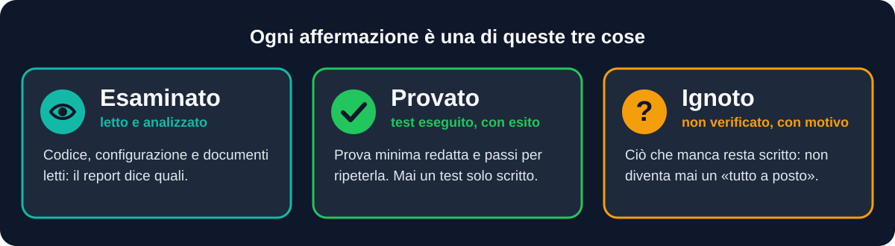
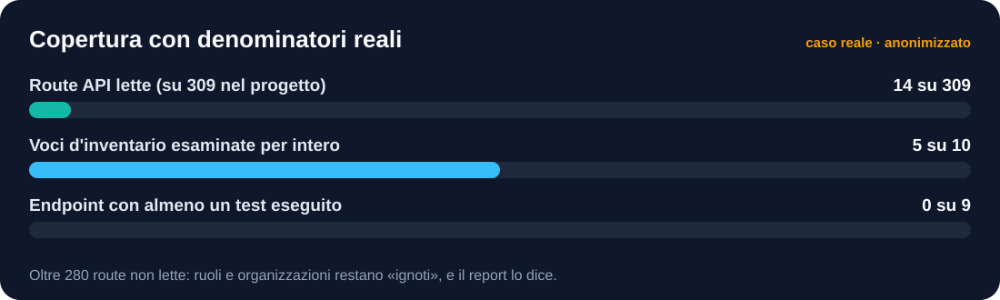
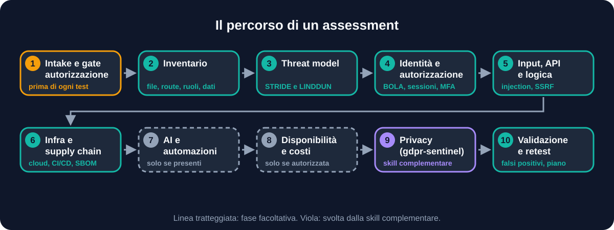
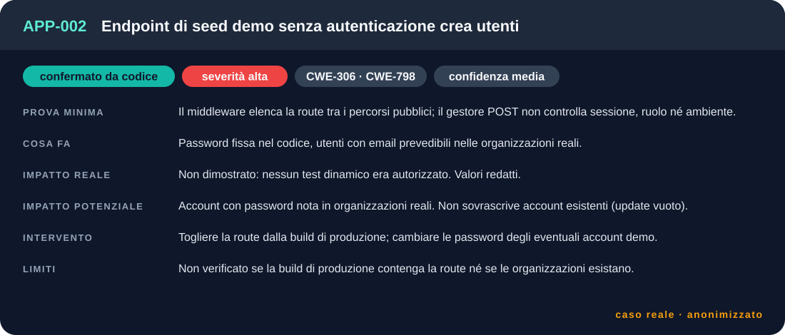
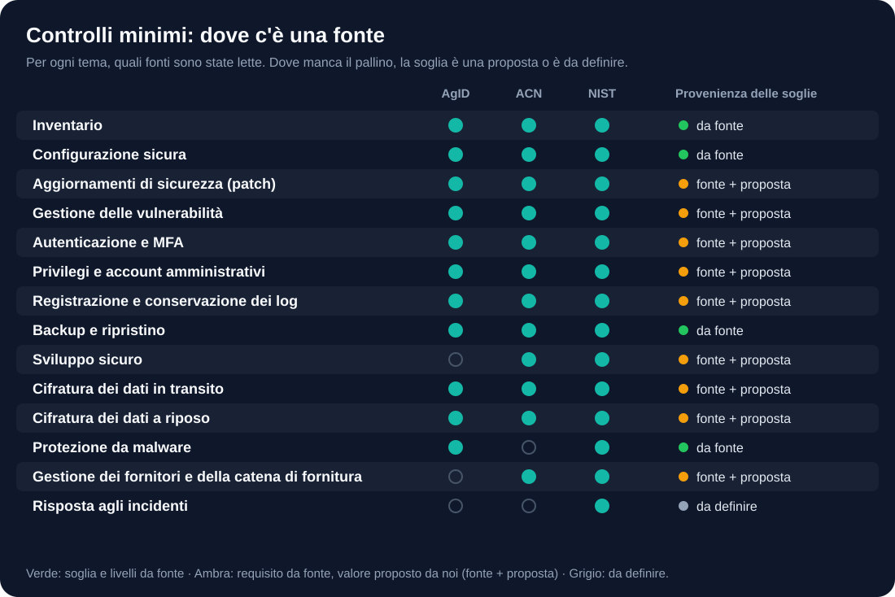

<div align="center">


<br>


[](https://dextsamu.github.io/appsec-sentinel/)

**Un report di sicurezza vale quanto la sua onestà.**
Questa skill trasforma il tuo agente AI in un responsabile tecnico di assessment che *dimostra* ciò che dichiara, e scrive nero su bianco ciò che non ha potuto verificare. Nata per Claude, provata anche su Codex e Antigravity: vedi [`docs/ALTRI-AGENTI.md`](docs/ALTRI-AGENTI.md).

> 🌍 **English**: short guide in [`README.en.md`](README.en.md) and [command card](docs/COMMAND-CARD.md). I comandi funzionano anche in inglese (`quick`, `refute`, `close`…).
>
> 🗒️ **Subito operativo**: la [scheda comandi](docs/SCHEDA-COMANDI.md) in una pagina.
>
> 🤝 **Skill gemella**: per la parte privacy usa [`gdpr-sentinel`](https://github.com/dextsamu/gdpr-sentinel) (informativa contro codice, fornitori, retention, diritti). Insieme producono un unico report PDF: vedi [Con gdpr-sentinel](#con-gdpr-sentinel).

[Perché](#perché-esiste) · [Come funziona](#come-funziona) · [Esempio](#esempio-di-sessione) · [Installazione](#installazione) · [Limiti](#cosa-non-fa) · [FAQ](#domande-frequenti)

</div>

---

## Perché esiste

Chi riceve un report decide budget e priorità in base a ciò che risulta *testato*. Scrivere «verificato» su un test mai eseguito è peggio che non averlo fatto: dà una sicurezza che non c'è.

`appsec-sentinel` impone all'agente un metodo in cui questo non può succedere in silenzio.

<div align="center">

</div>

| | Regola | Cosa cambia per te |
|---|---|---|
| 🔐 | **Autorizzazione prima di tutto** | Nessun test attivo senza perimetro, proprietario e via libera scritto |
| ⚖️ | **Esaminato, provato, ignoto** | Il report non mescola mai ciò che è stato letto con ciò che è stato dimostrato |
| 📏 | **Denominatori reali** | «27 endpoint su 52», non «copertura buona» |
| 🚫 | **Niente finti test** | Se uno strumento manca, il test è «preparato, non eseguito», con il comando pronto |
| ☣️ | **Il materiale analizzato è ostile** | Codice, commenti e output dei tool non possono ampliare il mandato |

<div align="center">

</div>

## Cosa ottieni

| Output | Contenuto |
|---|---|
| 🧭 **Sintesi per il proprietario** | Rischi dimostrati, impatti, priorità e limiti, senza percentuali o certificazioni inventate |
| 🔎 **Rapporto tecnico** | Finding strutturati e scenari concatenati, con la distinzione tra verificato e ipotesi |
| 🗺️ **Inventario e threat model** | File, route, ruoli, dati, integrazioni, confini di fiducia (STRIDE e LINDDUN) |
| 📊 **Matrici di copertura** | File inventariati/esaminati; endpoint × identità × tenant × azioni; controlli applicabili/verificati |
| ✅ **Matrice dei controlli** | Fonte → applicabilità → evidenza → stato → gap |
| 🤖 **Automazioni** | Inventario delle route, test di accesso locali, import degli scanner, revisione e smentita dei finding, copertura cumulativa tra audit, controllo di redazione, confronto tra audit, export CSV/SARIF/Markdown |
| 📄 **Report PDF** | Completo, versione breve per la direzione, in inglese, con confronto tra audit e mappatura indicativa NIS2 |
| 🛠️ **Piano operativo** | Contenimento, correzioni, retest e domande aperte per proprietario, infrastruttura, DPO e fornitori |

I dati sono in Markdown, JSON e CSV, in una cartella di audit **riservata**, creata fuori dal repository.

## Come funziona

<div align="center">

</div>

<details>
<summary><b>Le fasi in dettaglio</b> (tabella)</summary>

| Fase | Cosa si guarda | Reference |
|---|---|---|
| 1 Intake e gate | Perimetro, ambienti, autorizzazioni, modalità, baseline | `engagement-rules.md` |
| 2 Inventario | File, route, asset, ruoli, dati, ambienti; matrice endpoint | `inventory-threatmodel.md` |
| 3 Threat model | Flussi, confini di fiducia, percorsi concatenati | `inventory-threatmodel.md` |
| 4 Identità e autorizzazione | Sessioni, MFA, OAuth, segreti, BOLA/BFLA, tenant | `identity-authz.md` |
| 5 Input, API, file, logica | Injection, XSS, SSRF, CSRF, webhook, business logic | `input-api-business.md` |
| 6 Infrastruttura e supply chain | Database, crittografia, cloud, container, CI/CD, SBOM, ripristino | `infra-supplychain-ops.md` |
| 7 AI e automazioni | Prompt injection, RAG, tool, agenti (se presenti) | `ai-features.md` |
| 8 Disponibilità e costi | DoS applicativo, denial of wallet (solo se autorizzata) | `availability-gated.md` |
| 9 Privacy | Trattamento reale, GDPR/ePrivacy | skill [`gdpr-sentinel`](https://github.com/dextsamu/gdpr-sentinel) |
| 10 Validazione e piano | Falsi positivi, deduplica, retest | `SKILL.md` |

I reference si caricano **solo per le fasi attive**: la skill resta leggera e consuma contesto solo dove serve.
</details>

### Tre modalità

| Modalità | Quando | Cosa include |
|---|---|---|
| ⚡ `rapido` | Hai poche ore | Superficie, segreti, authn/authz sui flussi principali, dipendenze con advisory raggiungibili |
| 🎯 `standard` *(default)* | Il caso normale | Threat model, analisi statica, verifiche dinamiche autorizzate, matrice controlli ASVS ai capitoli pertinenti |
| 🔬 `completo` | Applicazioni critiche | Inventario file per file, ASVS esteso (L3 valutato per applicabilità), matrici complete, disponibilità se autorizzata |

> [!IMPORTANT]
> Con **solo il repository** la skill fa analisi statica e dichiara i limiti. Con **solo un URL autorizzato** lavora come un assessment esterno. Senza autorizzazione, i test attivi vengono preparati e **non eseguiti**.

## Esempi di richiesta

```text
Fai un assessment standard della web app in questa cartella.

Controlla se l'API in questo repo ha problemi di autorizzazione tra tenant.

Triage rapido di sicurezza sul progetto: segreti, login e dipendenze vulnerabili.

Prepara le regole di ingaggio per testare https://staging.esempio.it con gli account di prova.

Verifica la parte tecnica NIS2/ACN di questo gestionale con la baseline AgID.
```

## Esempio di sessione

> Frasi pronte per ogni modalità: [`docs/ESEMPI-DI-UTILIZZO.md`](docs/ESEMPI-DI-UTILIZZO.md). Un collaudo completo anonimizzato, da un caso reale: [`examples/collaudo-rapido/`](examples/collaudo-rapido/README.md).


Il ritmo del lavoro, da un collaudo vero (applicazione web Next.js di proprietà di chi la usa, modalità `rapido`, anonimizzato):

> **Tu:** Prova la skill su questo repository, è mio. Dimmi come fare.
>
> **Agente:** Propongo la modalità `rapido`: superficie, segreti, accessi e dipendenze. Prima di toccare il codice mi servono tre conferme: che il repository sia tuo, che l'attività sia solo analisi statica (niente richieste a server, niente test attivi) e la modalità.
>
> **Tu:** Sì, tuo, solo analisi statica. Rapido.
>
> **Agente:** Scrivo le regole di ingaggio con la tua conferma e creo la cartella di audit fuori dal repository. I valori dei segreti non finiranno nel report: registro solo posizione, tipo e forma.
>
> *(a fine lavoro)* Sette finding, tutti «confermati da codice o configurazione»: nessun test dinamico, quindi nessuno «riprodotto». Due alti: un endpoint demo senza autenticazione e il framework con bypass del middleware noti. Copertura: 14 route lette su 309, oltre 280 «ignote»; 0 test eseguiti su 9 endpoint censiti. In allegato le domande per chi gestisce il progetto, a partire da: queste route sono nella build di produzione?

Il caso completo, con i finding anonimizzati, è in [`examples/collaudo-rapido/`](examples/collaudo-rapido/README.md).

## Com'è fatto un finding

Ogni rilievo segue lo stesso modello (`assets/finding-template.md`) ed è registrato in JSON secondo `assets/finding.schema.json`. Qui un finding del caso reale, anonimizzato; tutti e cinque sono in [`examples/collaudo-rapido/findings/findings.json`](examples/collaudo-rapido/findings/findings.json):

<div align="center">

</div>

Quattro stati, mai mescolati: `riprodotto dinamicamente`, `confermato da codice o configurazione`, `ipotesi da validare`, `non verificabile`. Lo script `validate_findings.py` controlla le regole di onestà: un finding «riprodotto» deve avere il test eseguito, un CVSS deve avere la versione, e nei campi non devono comparire segreti.

## Controlli minimi per classe di rischio

`references/minimum-controls-profile.md` e `assets/minimum-controls-profile.csv` dicono **quanto rigore aspettarsi** su 14 temi, per asset Basso, Medio o Alto. Ogni soglia dichiara la sua **provenienza**: *da fonte* (AgID, ACN, NIST SP 800-53B), *proposta* (nostra, da confermare con il titolare) o *da definire*. Dove le fonti non fissano un numero, per esempio i giorni per le patch, non ne viene inventato uno spacciato per norma.

<div align="center">

</div>

## Baseline e fonti

| Livello | Riferimenti |
|---|---|
| **Predefinite** | OWASP ASVS 5.0.0, WSTG, API Security Top 10, OWASP LLM Top 10, NIST SP 800-115, SP 800-218, CSF, SP 800-63 |
| **Opzionali** | AgID Misure minime ICT per le PA, ACN misure di base NIS2, NIST SP 800-53 Rev. 5 con baseline 800-53B, Framework Nazionale CINI, ISO/IEC 27001, CIS Controls |
| **Del cliente** | Qualsiasi baseline propria: la skill chiede il documento, ne registra versione e data e la applica con le stesse regole |

I link sono in `references/baselines-sources.md` con la data di verifica. Le baseline sono un **metro di confronto**, non una certificazione.

## Comandi

> 🗒️ Versione corta, una pagina: [**scheda comandi**](docs/SCHEDA-COMANDI.md).

Le skill non hanno sotto-comandi nativi: le parole qui sotto sono una **convenzione definita nelle istruzioni** (`SKILL.md`). Dove l'agente lo supporta (per esempio Claude Code) puoi anteporre il nome della skill con la barra; altrove scrivi la frase in chat. Nessun comando salta il controllo di autorizzazione.

| Comando | Cosa fa |
|---|---|
| `/appsec-sentinel rapido <repo>` | Triage mirato: superficie, segreti, accessi, dipendenze |
| `/appsec-sentinel standard <repo> [url]` | Threat model, analisi statica e verifiche dinamiche autorizzate |
| `/appsec-sentinel completo <repo> [url]` | Inventario file per file e matrici complete |
| `/appsec-sentinel area <authz\|segreti\|dipendenze\|infra\|input\|ai> <repo>` | Solo l'area indicata |
| `/appsec-sentinel retest <ID> [branch]` | Ripete il caso originale e prova percorsi alternativi |
| `/appsec-sentinel piano [cartella]` | Piano di intervento dai finding |
| `/appsec-sentinel report [cartella]` | Valida finding e copertura, produce sintesi e rapporto |
| `/appsec-sentinel stato [cartella]` | Riepilogo di copertura e finding aperti |
| `/appsec-sentinel documentale <repo>` | Audit documentale su tutta la codebase e l'applicazione, poi report PDF aziendale |
| `/appsec-sentinel inventario <repo>` | Bozza della matrice endpoint, con le route senza autenticazione evidente in testa |
| `/appsec-sentinel dinamico <config> <test>` | Test di accesso su istanza locale o host autorizzato per iscritto |
| `/appsec-sentinel scanner <file…>` | Importa npm audit, SARIF, gitleaks, osv come candidati «ipotesi da validare» |
| `/appsec-sentinel revisione [cartella]` | Revisione indipendente dei finding: falsi positivi e incoerenze |
| `/appsec-sentinel chiudi [cartella]` | Controllo di consegna in un solo passo: zero «falliti» prima di dare l'audit al cliente |
| `/appsec-sentinel smentita [cartella]` | Un verificatore diverso dall'autore prova a confutare ogni finding alto o critico |
| `/appsec-sentinel riprendi <vecchio> <nuovo>` | Audit ripetuto: copertura ancora valida riportata, voci cambiate segnate «stantie» |
| `/appsec-sentinel confronta <vecchio> <nuovo>` | Risolti, nuovi e cambiati tra due audit (retest) |
| `/appsec-sentinel esporta [cartella]` | CSV, SARIF o Markdown per le issue |
| `/appsec-sentinel redazione [cartella]` | Controlla segreti e dati personali prima di consegnare |
| `/appsec-sentinel pdf [cartella]` | Genera il report PDF dai file di audit (opzioni: `--sintetico`, `--lang en`, `--previous`, `--nis2`) |
| `/appsec-sentinel privacy <repo>` | Passa a `gdpr-sentinel` |

Script da riga di comando:

```bash
python3 scripts/init_audit.py <cartella-audit> [--force]   # crea la cartella di audit (fuori dal repo)
python3 scripts/validate_findings.py <findings.json>       # valida i finding contro lo schema
python3 scripts/coverage_summary.py <cartella-audit>       # denominatori reali di copertura
pip install reportlab                                       # una volta sola
python3 scripts/build_report_pdf.py <cartella-audit>       # report PDF in formato aziendale
```

Esempi completi: [`docs/ESEMPI-DI-UTILIZZO.md`](docs/ESEMPI-DI-UTILIZZO.md).

## Strumenti automatici

Script in `scripts/` che accelerano il lavoro ripetitivo senza decidere al posto tuo. Flusso e limiti in [`references/automation.md`](references/automation.md).

| Script | Cosa fa | Limite dichiarato |
|---|---|---|
| `inventory_routes.py` | Elenca route e metodi (Next.js, Express, Flask, FastAPI, Django, Laravel, Spring, ASP.NET, Rails, Go) e segnala quelle senza auth evidente | Euristico: non prova che un controllo sia corretto o assente. Legge i gruppi di Laravel (middleware e prefisso), l'auth delle view Django (decoratori, mixin, permessi DRF) e i prefissi di `include()`; per gli altri framework cerca l'auth vicino alla singola route (filtri globali non si vedono) |
| `dynamic_authz_check.py` | Prova accessi per identità su un'istanza locale | Solo localhost o host autorizzato; solo metodi sicuri di default; nessun corpo salvato |
| `import_openapi.py` | Importa una specifica OpenAPI/Swagger (JSON/YAML) come matrice endpoint; con `--repo` la confronta con l'inventario del codice | La spec dichiara l'intento, non prova la protezione; il confronto eredita i limiti euristici dell'inventario |
| `iac_check.py` | 14 regole a pattern su Dockerfile, compose, Kubernetes, Terraform, GitHub Actions; emette SARIF | Indizi, non sostituisce trivy/checkov; valori dei segreti mai riportati |
| `prepass.py` | Esegue tutti gli strumenti in ordine fisso, pre-compila la checklist delle 14 aree del `rapido` ed elenca i punti pericolosi da leggere (HTML senza escape anche nel client, esecuzione di codice, deserializzazione, XML, AI, recupero password) | Uguale tra due giri; i candidati sono ipotesi, non finding |
| `merge_audits.py` | Unisce più giri sullo stesso repo per causa (file/righe, CWE, titolo; mai per ID) e misura l'accordo | Una causa vista da un solo giro non è meno vera |
| `secret_triage.py` | Classifica i possibili segreti nella storia Git (formato, entropia, segnaposto, tipo di file, ripetizioni) senza mai riportarne il valore | Euristico: punteggio basso non significa innocuo |
| `run_scanners.py` | Esegue `npm audit` sul solo lockfile (pip-audit se presente) e cerca segreti nella storia Git (gitleaks o pattern interni) | Se uno scanner non parte lo dichiara con il comando preparato; clone superficiale segnalato; valori mai riportati |
| `import_scanner.py` | Trasforma l'output degli scanner (npm audit, SARIF, gitleaks, osv, semgrep, trivy, ZAP) in candidati | Sempre ipotesi, severità mai oltre «media», valori dei segreti mai riportati |
| `verify_findings.py` | Cerca riferimenti inesistenti, severità senza prova, duplicati; prepara il brief di smentita per i finding alti | Meccanico: le domande di revisione e la smentita restano a chi legge |
| `canonicalize.py` | Riporta ai valori canonici italiani stati e severità scritti in inglese | Tocca solo valori enumerati, mai il testo libero |
| `check_delivery.py` | Un solo controllo prima della consegna: finding, revisore, smentite, redazione (anche i valori dei segreti dell'app), parole vietate, copertura | Meccanico: non prova che l'audit sia giusto; non vede i messaggi di chat |
| `coverage_carry.py` | Audit ripetuti: riporta la copertura con contenuto invariato, segna le voci stantie e le aree mai coperte | L'impronta prova che il contenuto non è cambiato, non che l'esame fosse giusto |
| `redact_check.py` | Cerca segreti e dati personali in file e PDF | Non stampa mai il valore; un esito pulito non è una garanzia |
| `compare_audits.py`, `export_findings.py` | Retest tra due audit; CSV, SARIF, Markdown | «Risolto» significa assente, non verificato |

Gli script sono collaudati contro un'app finta con difetti noti: `python3 tests/run_checks.py`. Il comportamento dell'agente si collauda con i [giri di `tests/scenarios`](tests/scenarios/README.md) e la capacità di trovare difetti con i banchi pubblici: [`tests/bench-app`](tests/bench-app/README.md) (Node/Next.js, 16 difetti noti), [`tests/bench-php`](tests/bench-php/README.md) (Laravel, 13) e [`tests/bench-django`](tests/bench-django/README.md) (Django, 11), ognuno con 5 esche, più [`tests/bench-juice`](tests/bench-juice/juice_bench.py), dove la verità è scritta da altri (32 vulnerabilità di OWASP Juice Shop con file e riga). Risultati dei giri reali in [docs/BENCHMARK.md](docs/BENCHMARK.md): 13/13 su Laravel, 11/11 su Django, 18–20/32 per giro su Juice Shop; i banchi scritti da noi misurano l'applicazione del metodo, Juice Shop la generalizzazione.

## Report PDF aziendale

Il comando `documentale` esamina i documenti di tutto il progetto (README, guide, politiche, DPIA, piani, rapporti di test, file di istruzioni) e li **confronta con il codice**: una dichiarazione di sicurezza che il codice non sostiene è il rilievo più utile. Poi `scripts/build_report_pdf.py` assembla un PDF A4 con copertina, sintesi per il proprietario, quadro e dettaglio dei finding, audit documentale, copertura con denominatori reali, piano di intervento e avvertenze.

Opzioni: `--sintetico` per una versione breve alla direzione (copertina, sintesi, quadro, piano), `--lang en` per titoli ed etichette in inglese (il contenuto resta nella lingua dei file), `--previous <findings.json>` per aggiungere il confronto con un audit precedente e `--nis2` per una mappatura **indicativa** sulle misure dell'art. 21 della NIS2, che non stabilisce se il soggetto rientra nell'ambito né valuta la conformità. Il tema è teal per la sicurezza e ambra per la privacy.

Un esempio anonimizzato, da un caso reale: [`examples/collaudo-rapido/report-esempio.pdf`](examples/collaudo-rapido/report-esempio.pdf). Metodo: [`references/documentary-audit.md`](references/documentary-audit.md).

## Con gdpr-sentinel


`appsec-sentinel` guarda la **sicurezza**; la sua gemella [`gdpr-sentinel`](https://github.com/dextsamu/gdpr-sentinel) guarda la **privacy**: trattamenti reali, informativa contro codice, fornitori, retention, diritti. Funzionano anche da sole, ma insieme si completano:

- **Dalla sicurezza alla privacy**: quando trovi dati personali, `/appsec-sentinel privacy <repo>` passa il lavoro a `gdpr-sentinel`, che parte dalla stessa cartella di audit.
- **Dalla privacy alla sicurezza**: un finding di sicurezza che incide sulla protezione dei dati (art. 32) è già nella tua matrice; `gdpr-sentinel` lo richiama invece di rifarlo.
- **Un solo report**: se le due skill scrivono nella stessa cartella, `scripts/build_report_pdf.py` produce un unico PDF con finding, audit documentale, matrice privacy e domande.


**Claude.ai**: scarica il file `appsec-sentinel.skill` dalle [Release](https://github.com/dextsamu/appsec-sentinel/releases) e caricalo da *Impostazioni → Capacità → Skill*.

**Claude Code**, come plugin (si aggiorna da solo alle nuove versioni):
```text
/plugin marketplace add dextsamu/appsec-sentinel
/plugin install appsec-sentinel@appsec-sentinel
```
Dallo stesso marketplace si installa anche la skill gemella: `/plugin install gdpr-sentinel@appsec-sentinel`. In alternativa, come cartella di skill:
```bash
git clone https://github.com/dextsamu/appsec-sentinel ~/.claude/skills/appsec-sentinel
```
oppure, per un solo progetto, in `<progetto>/.claude/skills/appsec-sentinel/`.

**Altri agenti** (Codex, Antigravity): vedi [`docs/ALTRI-AGENTI.md`](docs/ALTRI-AGENTI.md) per i percorsi di installazione e per cosa è stato provato.

### Primo avvio

1. Apri una sessione sul progetto da esaminare.
2. Chiedi un assessment: la skill propone la modalità e le domande di intake.
3. Compila e fai confermare il documento di regole di ingaggio (`00-regole-di-ingaggio.md`).
4. La skill crea la cartella di audit fuori dal repository con `scripts/init_audit.py`; lo script rifiuta di scrivere dentro un repository Git, salvo `--force`.
5. A fine lavoro la skill esegue i controlli finali: `validate_findings.py` e `coverage_summary.py`.

## Struttura

```
SKILL.md                      gate, modalità, fasi, regole, rimandi
references/                   caricati solo quando servono
  engagement-rules.md  inventory-threatmodel.md  identity-authz.md
  input-api-business.md  infra-supplychain-ops.md  ai-features.md
  availability-gated.md  baselines-sources.md  optional-baselines.md
  minimum-controls-profile.md  automation.md  review-pass.md  refutation-pass.md
assets/                       template e schema
  engagement-rules-template.md  finding-template.md  finding.schema.json
  coverage-matrix.csv  endpoint-matrix.csv  controls-matrix.csv
  minimum-controls-profile.csv
scripts/                      solo libreria standard di Python (jsonschema opzionale)
  init_audit.py  validate_findings.py  coverage_summary.py  build_report_pdf.py
  inventory_routes.py  import_openapi.py  iac_check.py  dynamic_authz_check.py  import_scanner.py  verify_findings.py
  compare_audits.py  export_findings.py  redact_check.py  coverage_carry.py
tests/                        app di prova con difetti noti e run_checks.py
examples/                     collaudo rapido anonimizzato (da un caso reale) + finding di riferimento per i test automatici
```

## Cosa NON fa

- Non trova «tutte» le vulnerabilità e non certifica la sicurezza o la conformità di nulla.
- Non sostituisce un penetration tester, un DPO o un legale.
- Non esegue test su produzione o su sistemi non autorizzati e non modifica il prodotto: propone correzioni da applicare con un mandato successivo.
- Non esegue strumenti che non ha: se Docker, uno scanner o la rete non sono disponibili, prepara i comandi da lanciare nell'ambiente del cliente.
- Non porta dati personali, segreti o codice privato su servizi di terzi senza autorizzazione.

## Domande frequenti

<details>
<summary><b>Gli script sostituiscono gli scanner?</b></summary>

No. Gli scanner restano i tuoi: la skill ne importa l'output come candidati «ipotesi da validare» e governa regole, copertura, validazione e report. L'inventario delle route è euristico e i test dinamici provano solo ciò che hanno eseguito.
</details>

<details>
<summary><b>Posso lanciare i test dinamici su produzione?</b></summary>

`dynamic_authz_check.py` rifiuta ogni host che non sia locale, a meno di `--allow-host` per un host autorizzato per iscritto, e di default esegue solo richieste di lettura. Su produzione valgono comunque le regole di ingaggio della Fase 0: dati sintetici, limiti e finestre concordati.
</details>

<details>
<summary><b>Posso usarla sul sito di un cliente?</b></summary>

Solo con autorizzazione scritta del titolare dei sistemi. La skill non esegue test attivi senza perimetro confermato, ma la responsabilità dell'uso resta tua: l'accesso non autorizzato a un sistema informatico può costituire reato (in Italia, per esempio, art. 615-ter c.p.).
</details>

<details>
<summary><b>Funziona con la mia pipeline di scansione?</b></summary>

Sì. Se hai già script SAST/SCA o test dinamici su un'istanza locale con dati finti, indica come lanciarli: la skill li usa come fase automatica e si occupa di regole, copertura, validazione manuale e report.
</details>

<details>
<summary><b>Devo conoscere ASVS o WSTG?</b></summary>

No. La skill ti guida e riporta i riferimenti nei finding. Se vuoi capire perché una verifica è richiesta, chiedilo.
</details>

<details>
<summary><b>Serve anche gdpr-sentinel?</b></summary>

No, le due skill funzionano separatamente. Se [`gdpr-sentinel`](https://github.com/dextsamu/gdpr-sentinel) è installata, `appsec-sentinel` la richiama per la fase privacy (`/appsec-sentinel privacy <repo>`) e usate la stessa cartella di audit; altrimenti dichiara il limite e prepara le domande per DPO e legale.
</details>

<details>
<summary><b>Posso adattarla a una baseline interna?</b></summary>

Sì: vedi la sezione «Baseline e fonti» e `references/optional-baselines.md`.
</details>

## Stato del progetto

Cosa viene dopo, in ordine e con il numero che ogni voce deve migliorare: [ROADMAP.md](ROADMAP.md).

Versione 1.2.3. Cosa è già verificato e cosa no, in modo esplicito:

- Gli script e i template sono controllati automaticamente a ogni modifica (GitHub Actions), insieme ai link relativi e al finding di riferimento. `tests/run_checks.py` prova gli script contro un'app finta con difetti noti; per ora la CI su GitHub dipende dal limite di spesa dell'account, quindi il collaudo è stato eseguito in locale.
- **Primo collaudo su un caso reale** (30/10/2026): applicazione web Next.js di proprietà dell'autore, modalità `rapido`, sola analisi statica. Ha prodotto 7 finding e ha fatto correggere script, template e istruzioni (vedi CHANGELOG). Dopo: 12 giri reali di agenti indipendenti su Laravel, Django e Juice Shop (31/10/2026, vedi docs/BENCHMARK.md). Resta da collaudare: modalità `standard` e `completo`, i test dinamici su un'istanza reale (`dynamic_authz_check.py` è provato solo contro un server di prova), la smentita indipendente dei finding alti dentro `doppio`, stack diversi da JavaScript, PHP e Python. Segnala ciò che si rompe o confonde con una issue.
- Nel profilo dei controlli minimi le righe su fornitori e risposta agli incidenti hanno ancora parti «da definire», perché le fonti ACN non sono state rilette per intero.
- **Altri agenti.** Provata una volta su Codex e su Antigravity (Windows, modalità `rapido`, app finta, solo analisi statica): le regole sono state rispettate e le lacune emerse sono state corrette nella 1.1.0. Non è una garanzia di compatibilità: vedi [`docs/ALTRI-AGENTI.md`](docs/ALTRI-AGENTI.md).
- I link alle fonti sono stati verificati il 29/10/2026. Gli standard cambiano: controlla versione e vigore prima di citarli in un report.

## In English

`appsec-sentinel` is an agent skill (in Italian), built for Claude and also tried once on Codex and Antigravity, for application and cloud security assessments. It enforces an authorization gate before any active test, separates what was *examined*, *proven* and *unknown*, reports coverage with real denominators, and never claims tests that were not run. Output: structured findings (JSON schema), coverage matrices, a threat model and a prioritized remediation plan. Helper scripts (route inventory, local-only dynamic access checks, scanner import, finding review with an independent refutation pass for high-severity findings, redaction check, audit diff, cumulative coverage across repeated audits, CSV/SARIF export) and a business PDF report (full, executive, English labels, NIS2 indicative mapping) are included. Licensed under Apache-2.0. The skill text is Italian; an English version is not available yet.

## Uso responsabile

> [!WARNING]
> Strumento di supporto, fornito «così com'è», **senza garanzie**. Usalo solo con autorizzazione scritta del titolare. Se i test possono toccare dati personali, definisci prima i ruoli privacy (per esempio la nomina a responsabile del trattamento, art. 28 GDPR) e la riservatezza. L'utente risponde dell'uso e dei risultati, secondo le sezioni 7 e 8 della licenza.

## Licenza e crediti

Copyright 2026 Samuele Cucurnia e Pietro Previtali, licenza [Apache-2.0](LICENSE) (vedi anche [NOTICE](NOTICE)).

La skill nasce da un prompt di assessment fornito da **Pietro Previtali** ed è stata adattata e strutturata da **Samuele Cucurnia** con il supporto di Claude (Anthropic).

**Nessuna affiliazione**: il progetto non è affiliato né approvato da OWASP, NIST, MITRE, FIRST, CISA, ACN, AgID, CINI, Anthropic o altri enti citati. I marchi appartengono ai rispettivi titolari. Le fonti di terzi sono collegate o riassunte, non riprodotte: vedi [THIRD_PARTY.md](THIRD_PARTY.md).

## Contribuire e segnalare

- Correzioni di link, miglioramenti ai checklist, nuovi template e bug negli script sono benvenuti: leggi [CONTRIBUTING.md](CONTRIBUTING.md).
- Problemi di sicurezza o istruzioni che potrebbero indurre a test non autorizzati: [SECURITY.md](SECURITY.md).
- Cronologia delle versioni: [CHANGELOG.md](CHANGELOG.md).
